# Kubernetes Notes

A project-driven curriculum for learning containers, microservices architecture,
Kubernetes, Helm, observability, delivery, and production operations.

This repository develops three abilities together:

1. Explain how cloud-native systems work.
2. Build and operate them through reproducible labs.
3. Reason through architecture and troubleshooting interviews.

The material grows around one evolving capstone. It starts locally, moves into
containers, and becomes a production-aware Kubernetes deployment with Helm,
Prometheus, Grafana, OpenTelemetry, GitOps, security controls, and runbooks.

## Start here

- **New learner:** read the [learning guide](LEARNING-GUIDE.md), then begin with
  [Module 00 — Prerequisites](curriculum/00-prerequisites/README.md).
- **See the full order:** use the [roadmap](ROADMAP.md) to move through modules
  sequentially. Available modules are linked directly from its learning path.
- [Curriculum](curriculum/README.md) — module catalog and content contract
- [Competency gates](curriculum/ASSESSMENT-GATES.md) — cumulative practical assessments
- [Labs](labs/README.md) — exercise conventions
- [Interview preparation](interview/README.md) — questions and scenarios
- [CloudCart capstone](capstone/README.md) — the evolving system
- [Version matrix](VERSION-MATRIX.md) — tested tool baselines
- [Contributing](CONTRIBUTING.md) — authoring and review standards

## Learning path

```mermaid
flowchart LR
    A[Linux and networking] --> B[Containers and Docker]
    B --> C[Microservices architecture]
    C --> D[Kubernetes core]
    D --> E[Networking and storage]
    E --> F[Security and resources]
    F --> G[Helm]
    G --> H[Metrics, logs, and traces]
    H --> I[CI/CD and GitOps]
    I --> J[Production operations]
    J --> K[Advanced Kubernetes and graduation]
```

## Principles

- Learn the mechanism before adding an abstraction.
- Use plain Kubernetes manifests before packaging them with Helm.
- Treat failure diagnosis as part of every subject.
- Prefer official documentation as the primary external reference.
- Keep labs repeatable, versioned, and safe to clean up.
- Explain tradeoffs instead of declaring one tool universally correct.
- Never commit credentials, private keys, or real production data.

## Status

All 17 ordered modules are published and runtime-verified against the baselines
in the [version matrix](VERSION-MATRIX.md). The CloudCart capstone evolves from
a local Python application through containers, Kubernetes, Helm, observability,
GitOps, production operations, and advanced-platform evaluation. Examples
target Linux and, where practical, Windows through WSL2 and Docker Desktop.
Cloud exercises identify billable resources explicitly.

## Continue learning

Every module ends with navigation back to the curriculum index and to the next
step. Use the cumulative [competency gates](curriculum/ASSESSMENT-GATES.md) to
verify transfer instead of treating page completion as demonstrated skill.
