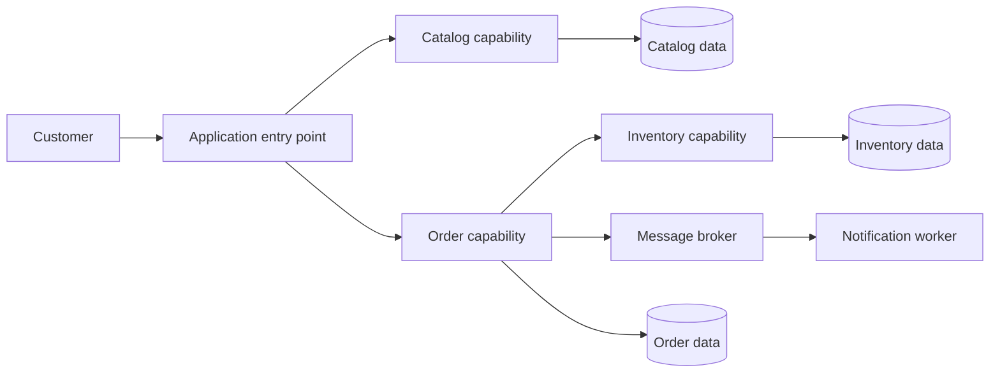

# Capstone Architecture

This is a capability diagram, not the initial deployment topology. Multiple
capabilities may begin in one process.

## Artifacts

- [Requirements](requirements.md)
- [Architecture decisions](decisions/README.md)
- [Threat model](threat-model.md)

Future phases add API contracts, event schemas, deployment diagrams, data
ownership, dependency maps, SLOs, and recovery models.

## Constraints

- Each data set has one owning capability.
- Cross-capability writes use an owned API or event contract.
- External calls have explicit timeout and failure behavior.
- At-least-once delivery must not cause duplicate business effects.
- Production-like workloads expose health and telemetry signals.
- Security boundaries and operational ownership are part of the design.
