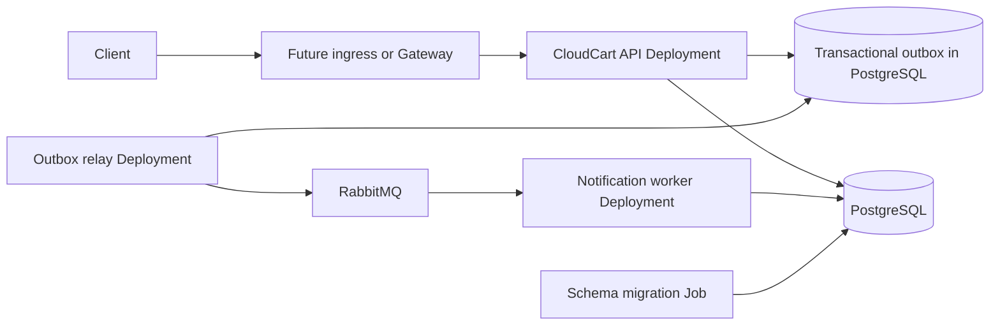

# CloudCart Kubernetes Deployment Plan

This document maps the existing CloudCart runtime to Kubernetes responsibilities.
It is an architecture input for Module 05, not a deployable manifest set.

## Target topology

The API, outbox relay, and notification worker are separate processes with
different scaling and failure behavior. They share the Module 03 codebase and
business contracts but do not need to share a Pod.

## Planned Kubernetes mapping

| Concern | Planned resource or boundary | Reason |
|---|---|---|
| API process | Deployment and ClusterIP Service | stateless replicas and stable in-cluster discovery |
| Outbox relay | Deployment, initially one replica | continuous process; concurrency must preserve safe claiming and delivery |
| Notification worker | Deployment | independently scalable consumer with idempotent database effect |
| Schema migration | versioned Job run before compatible application rollout | finite, observable operation rather than every replica racing at startup |
| Process configuration | ConfigMap for non-sensitive settings | separates deploy-time configuration from image content |
| Credentials | Secret reference supplied by an approved secret workflow | values must not be committed; base64 is not protection |
| PostgreSQL and RabbitMQ | local learning workloads first; managed/external options evaluated later | state, backup, upgrades, and availability need dedicated treatment |
| External entry | deferred to networking module | avoid selecting ingress/Gateway and TLS behavior before Module 06 |
| Persistence | deferred to storage module | requires StorageClass, CSI, backup, and restore decisions from Module 07 |

## Ownership and reconciliation

- Deployment controllers own ReplicaSets; ReplicaSets own application Pods.
- The scheduler chooses feasible nodes; kubelets and the runtime realize assigned Pods.
- CloudCart application processes own business behavior, not Kubernetes controllers.
- PostgreSQL remains the source of truth for orders, processed-message identity,
  and the transactional outbox. Kubernetes API state is not application backup.
- RabbitMQ transports messages; it is not the source of truth for committed orders.

## Availability and rollout constraints

- API readiness must mean it can serve traffic, while liveness must not turn a
  downstream outage into restart churn. Startup behavior is considered separately.
- Relay and worker health must expose stalled processing without creating duplicate effects.
- Resource requests are required before scheduling or capacity claims are meaningful.
- Termination must allow bounded request/message completion and stop accepting new work.
- Application and schema changes require an expand/migrate/contract compatibility sequence.
- Multiple replicas must preserve idempotency and safe outbox claiming.

## Security constraints

- Keep the existing non-root, read-only-root-filesystem, dropped-capability posture where feasible.
- Use dedicated service accounts and add only proven RBAC needs; application
  Pods currently need no permission to call the Kubernetes API.
- Never commit kubeconfigs, tokens, private keys, or populated Secret manifests.
- Restrict network paths and secret delivery in their dedicated modules.

## Deferred decisions

Module 05 will implement minimal Deployments, Services, Jobs, probes,
configuration, rollouts, and resource requests. Modules 06–10 will decide
network entry/policy, persistent storage and recovery, secret delivery,
scheduling policy, and security controls. Helm and observability remain later
packaging and operational layers, not prerequisites for plain-manifest learning.

## Acceptance criteria for Module 05

- Plain manifests create the intended ownership graph and converge on a local cluster.
- A migration Job completes before the compatible application version is verified.
- API, relay, and worker behavior survives controlled Pod replacement without duplicate business effects.
- Status, conditions, Events, logs, and runtime evidence locate a seeded failure.
- Cleanup targets only CloudCart resources and leaves no credentials or generated kubeconfig in Git.
